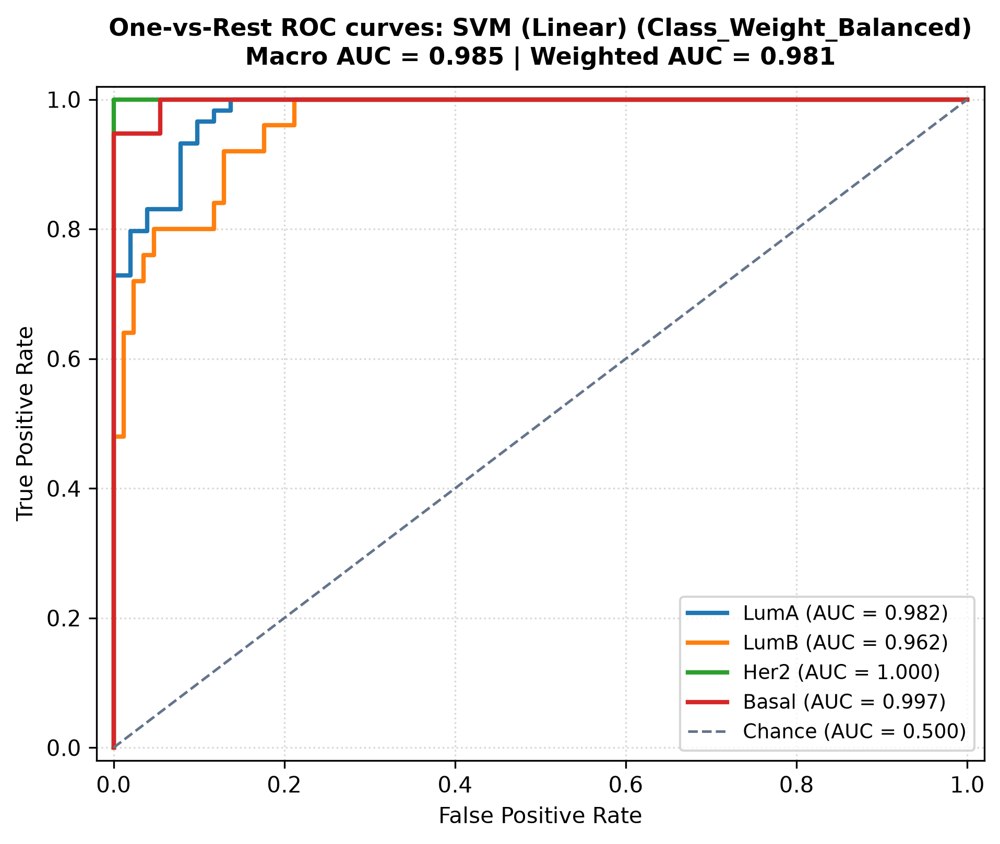
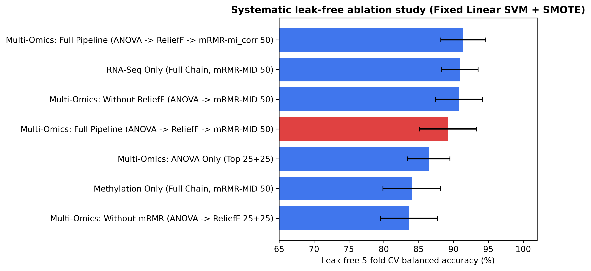
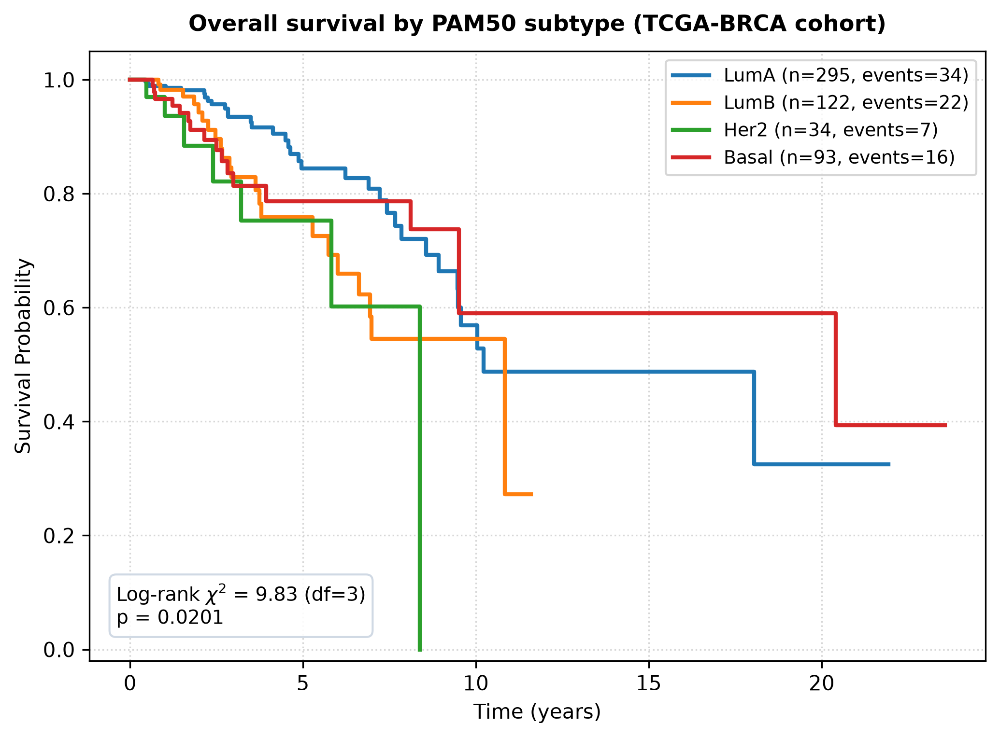
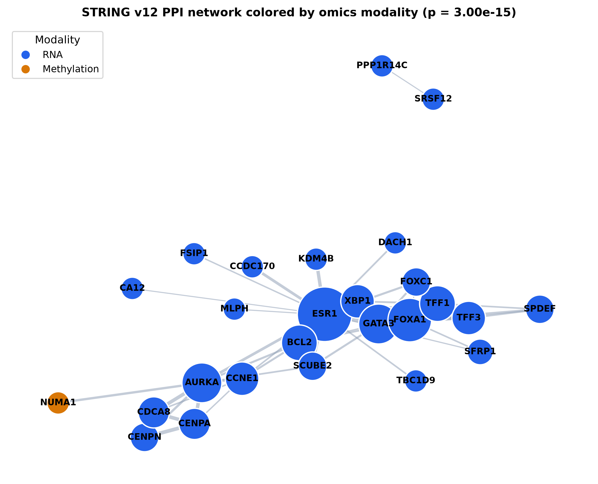

# Breast Cancer PAM50 Subtype Prediction from Multi-Omics Data

This repository predicts the four intrinsic breast cancer subtypes (`LumA`, `LumB`, `Her2`, `Basal`) in the TCGA-BRCA cohort (`N = 549` primary tumors) by combining RNA-Seq expression (`20,155` genes) with Illumina 450K DNA methylation (`20,106` genes). A four-stage feature selection chain (unscaled variance filtering, ANOVA F-test, multi-class ReliefF, and mRMR-MID) reduces `40,261` input features to `50` markers (`43` RNA and `7` DNA methylation).

Every preprocessing step, selector, resampling step, and cross-validation loop runs inside the six sequential Jupyter notebooks under `notebooks/`, with exact numerical parity in `run_pipeline.py`. On `5 x 2` repeated nested CV starting from raw splits, `SVM (Linear)` with `class_weight='balanced'` achieved the highest training balanced accuracy (`91.49% ± 3.09%`) and reached `0.9853` macro ROC-AUC on the held-out test set (`N = 110`). On that same held-out test split, `Random Forest` reached `90.00%` accuracy and `92.14%` balanced accuracy.

## Dataset and measured properties (`data/`)

The raw files come from the Broad Institute GDAC Firehose `2016_01_28` release for TCGA-BRCA:

- **RNA-Seq (`20,155` genes x `1,093` samples):** Values are already `log2(RSEM + 1)` transformed in `[0.0, 20.98]`, with `0` missing entries and `7` zero-variance genes. No extra log transformation is applied.
- **DNA Methylation (`20,106` genes x `783` samples):** Gene-level HM450 values are already `0.5`-centered beta values spanning `[-0.4969, +0.4964]` (median `-0.0756`), containing `4,293` missing entries across `1,327` genes in the synchronized cohort (maximum `5.6%` missingness in any gene).
- **Clinical metadata (`20` attributes x `1,097` patients):** Intersecting valid PAM50 labels with both molecular assays yields `549` primary tumor patients (`LumA`: `296`, `LumB`: `122`, `Basal`: `96`, `Her2`: `35`). Tumor purity (`546/549`), overall survival and vital status (`544/549`), pathologic stage (`542/549`), and age (`538/549`) are well populated, whereas Firehose IHC receptor calls (`ER.Status`, `PR.Status`, `HER2.Status`) are present for only `31/549` patients.

Across both assays, `18,957` gene symbols overlap directly and all `50/50` canonical PAM50 genes are present in both RNA and methylation (`ORC6` appears under its 2016 Firehose symbol `ORC6L`).

## Pipeline and leakage controls

The workflow is split across six sequential notebooks whose filenames stay fixed from step `01` to step `06`:

| Step | Notebook | Core operations |
| :--- | :--- | :--- |
| `01` | `notebooks/Reading.ipynb` | Synchronizes `549` patients, audits scales and missingness, checks `50/50` PAM50 gene coverage, and tests tumor purity across subtypes |
| `02` | `notebooks/preprocessing.ipynb` | Stratified `80/20` split (`SPLIT_SEED = 100`, `439` train / `110` test), persists raw splits, fits `SimpleImputer(strategy='median', keep_empty_features=True)` on train only, plots RNA and methylation PCA |
| `03` | `notebooks/Feature_Selection_1.ipynb` | Unscaled bottom-`20%` variance filter (`0.2690` RNA -> `16,124` kept; `0.00062` methylation -> `16,084` kept), `50`-gene PAM50 survival check, `MinMaxScaler(clip=True)` |
| `04` | `notebooks/Feature Selection_2.ipynb` | One-way ANOVA F-test + Benjamini-Hochberg FDR (`k = 500` per modality), leak-free `5`-fold CV (`89.75%` LDA accuracy), and sensitivity curve (`k` from `100` to `1000`) |
| `05` | `notebooks/Feature Selection_3.ipynb` | Vectorized Kononenko (1994) multi-class ReliefF (`k = 150` per modality, `~0.089s`), leak-free `5`-fold CV (`87.69%` LDA accuracy), and sensitivity curve (`k` from `50` to `250`) |
| `06` | `notebooks/Feature Selection_4.ipynb` | mRMR-MID (`k = 50`), full-chain stability, `5 x 2` nested CV, `7`-config ablation, single-pass test evaluation, clinical survival and purity checks, and biological database validation |

Three design choices prevent optimistic bias in the reported numbers:

1. **In-fold preprocessing and selection.** Sensitivity curves, feature stability (`J = 0.4043 ± 0.0494`, with `18` markers appearing in `5/5` folds), the `7`-configuration ablation, and `5 x 2` repeated nested CV all start from raw un-imputed training splits (`X_train_*_raw`) and refit every imputer, variance threshold, scaler, and selector inside each fold.
2. **SMOTE inside `GridSearchCV`.** When evaluating `SMOTE`, oversampling runs inside `imblearn.pipeline.Pipeline` inside `GridSearchCV` so synthetic minority samples (`Her2`, `n = 28` in training) never cross inner validation boundaries.
3. **Unbiased model selection.** Both `SMOTE` and `class_weight='balanced'` are compared across four classifiers (`SVM (Linear)`, `Random Forest`, `KNN (Tuned)`, and `Logistic Regression (L2)`), and the winning pair is chosen strictly from training nested CV balanced accuracy before touching the held-out test set once.

## Classification results

### Repeated nested cross-validation (`5 x 2` outer folds from raw splits)

| Model | Strategy | CV Accuracy | CV Balanced Accuracy | CV Macro F1 | CV Macro ROC-AUC |
| :--- | :--- | :---: | :---: | :---: | :---: |
| **SVM (Linear)** *(CV winner)* | `Class_Weight_Balanced` | 89.75% ± 1.46% | **91.49% ± 3.09%** | 90.41% | 0.9768 |
| Logistic Regression (L2) | `Class_Weight_Balanced` | 90.32% ± 2.04% | 91.35% ± 3.29% | 90.00% | **0.9815** |
| Logistic Regression (L2) | `SMOTE` | 90.78% ± 1.46% | 91.13% ± 2.62% | 90.72% | 0.9814 |
| Random Forest | `Class_Weight_Balanced` | **91.34% ± 2.61%** | 91.01% ± 3.95% | **91.19%** | 0.9811 |
| SVM (Linear) | `SMOTE` | 90.09% ± 1.97% | 90.91% ± 2.54% | 90.38% | 0.9755 |
| Random Forest | `SMOTE` | 91.34% ± 2.93% | 90.76% ± 3.83% | 90.98% | 0.9801 |
| KNN (Tuned) | `SMOTE` | 86.56% ± 2.52% | 89.13% ± 2.60% | 87.57% | 0.9572 |
| KNN (Tuned) | `Class_Weight_Balanced` | 88.39% ± 2.80% | 85.80% ± 5.34% | 87.45% | 0.9524 |

### Held-out test evaluation (`N = 110`, strategy = `Class_Weight_Balanced`)

| Model | Test Accuracy [95% CI] | Balanced Acc | Macro F1 [95% CI] | Weighted F1 | Macro ROC-AUC | Macro PR-AUC | Her2 F1 (`N = 7`) |
| :--- | :---: | :---: | :---: | :---: | :---: | :---: | :---: |
| Random Forest | **90.00%** [83.64% - 95.45%] | **92.14%** | **90.69%** [82.87% - 95.65%] | **90.11%** | 0.9782 | 0.9530 | 93.3% [75.0% - 100%] |
| Logistic Regression (L2) | 88.18% [81.82% - 93.64%] | 91.87% | 89.48% [82.28% - 94.77%] | 88.61% | 0.9837 | 0.9645 | 93.3% [73.7% - 100%] |
| **SVM (Linear)** *(CV winner)* | 85.45% [78.18% - 91.82%] | 91.18% | 87.90% [81.10% - 93.22%] | 86.16% | **0.9853** | **0.9677** | 93.3% [73.7% - 100%] |
| KNN (Tuned) | 85.45% [79.09% - 91.82%] | 85.41% | 86.85% [80.23% - 91.68%] | 84.54% | 0.9654 | 0.9197 | **100.0%** [100% - 100%] |



### Leak-free ablation study (fixed Linear SVM + in-fold SMOTE, `5`-fold CV from raw splits)

| Configuration | Mean RNA / Meth | CV Accuracy | CV Balanced Accuracy | CV Macro F1 |
| :--- | :---: | :---: | :---: | :---: |
| Multi-Omics: Full Pipeline (`ANOVA -> ReliefF -> mRMR-mi_corr 50`) | 32.6 / 17.4 | 91.11% | **91.41%** | 90.77% |
| RNA-Seq Only (`Full Chain, mRMR-MID 50`) | 50.0 / 0.0 | **91.35%** | 90.92% | **90.93%** |
| Multi-Omics: Without ReliefF (`ANOVA -> mRMR-MID 50`) | 40.8 / 9.2 | 90.89% | 90.79% | 90.09% |
| Multi-Omics: Full Pipeline (`ANOVA -> ReliefF -> mRMR-MID 50`) | 41.2 / 8.8 | 90.21% | 89.23% | 89.29% |
| Multi-Omics: ANOVA Only (`Top 25+25`) | 25.0 / 25.0 | 82.48% | 86.44% | 84.92% |
| Methylation Only (`Full Chain, mRMR-MID 50`) | 0.0 / 50.0 | 81.32% | 84.00% | 81.64% |
| Multi-Omics: Without mRMR (`ANOVA -> ReliefF 25+25`) | 25.0 / 25.0 | 82.45% | 83.59% | 81.56% |

RNA-only (`91.35%` CV accuracy) matches or slightly edges multi-omics (`90.21%` under `mRMR-MID` and `91.11%` under `mi_corr`) because PAM50 subtypes are defined by a `50`-gene mRNA expression signature. Dropping mRMR redundancy removal reduces CV accuracy by roughly `8` to `9` percentage points (`82.45%` without mRMR vs `90.21%-91.11%` with mRMR).



## Clinical and biological validation

### Legacy symbol harmonization (Ensembl GRCh38)

Querying Ensembl GRCh38 mapped `49/50` selected biomarkers to stable `ENSG` identifiers (`LOC100130148` remains an uncharacterized locus) and resolved `7` outdated 2016 Firehose symbols (`LRRC6` -> `DNAAF11`, `C5orf33` -> `NADK2`, `CASC1` -> `DNAI7`, `C6orf97` -> `CCDC170`, `SFRS13B` -> `SRSF12`, `GPR77` -> `C5AR2`, `CCDC41` -> `CEP83`). Mapping `C6orf97` to `CCDC170` surfaced the second highest-scoring breast cancer target in Open Targets (`0.5068`, recurrent `ESR1-CCDC170` fusion locus). Nine of the `50` markers belong to the canonical PAM50 panel (`ESR1`, `FOXA1`, `MLPH`, `FOXC1`, `MIA`, `NAT1`, `CCNE1`, `BCL2`, `SFRP1`), while `41` are non-PAM50 multi-omics features.

### Cis epigenetics, tumor purity caveat, and survival

- **Cis RNA-methylation correlation (`N = 549`).** All `50/50` biomarkers present in both matrices exhibit significant negative Spearman correlation (`BH-FDR < 0.05`), led by `SLC44A4` (`rho = -0.794`), `GATA3` (`-0.778`), `BCL2` (`-0.773`), `SCUBE2` (`-0.766`), `ESR1` (`-0.715`), and `FOXA1` (`-0.699`).
- **Tumor purity confounding (`N = 546`).** TCGA tumor purity varies across PAM50 subtypes (Kruskal-Wallis `H = 27.21`, `p = 5.31e-06`). Across the `50` selected features, median `|rho_purity|` is `0.255` and the five most purity-correlated markers are all bulk DNA methylation loci (`|rho| = 0.522-0.614`, including Rank 1 `Meth_LRRC6 / DNAAF11`, which is not detected in normal breast epithelium in Human Protein Atlas). Bulk methylation signals therefore reflect stromal/immune admixture alongside tumor-intrinsic subtype differences.
- **Overall survival (`N = 544`).** Kaplan-Meier analysis separates PAM50 subtypes across the full cohort (Mantel-Cox log-rank `chi2 = 9.83`, `df = 3`, `p = 0.0201`). On the smaller held-out test split (`N = 110`), predicted subtype curves do not reach statistical significance (`chi2 = 1.02`, `p = 0.7966`) due to low event counts.



### Pathways, PPI network, druggability, and protein structure (`Homo sapiens`, Taxon `9606`)

- **Reactome (v98) and STRING v12.** Combined biomarkers enrich for *Estrogen-dependent gene expression* (`R-HSA-9018519`, `FDR = 5.91e-09`) and *ESR-mediated signaling* (`R-HSA-8939211`, `FDR = 5.91e-09`), whereas the `7` methylation markers span orthogonal processes (`NUMA1`, `CEP83`, `NADK2`, `CSAD`) with nominal `p < 0.05` hits only. STRING v12 maps `47/50` genes with `51` edges vs `13` expected (`p = 3.00e-15`) and `104` significant functional terms (`FDR < 0.05`), led by hubs `ESR1` (degree `17`), `FOXA1` (`10`), `GATA3` (`8`), and `AURKA` (`8`).
- **Open Targets, HPA, UniProt, AlphaFold DB, and ClinicalTrials.gov.** Open Targets (`MONDO_0004989` / `MONDO_0007254`) scores `49` biomarkers and links `35` breast cancer drugs to `ESR1` (Tamoxifen, Fulvestrant, Elacestrant), `AURKA` (Alisertib), and `BCL2` (Venetoclax, Navitoclax), alongside `14` Phase 2-3 trials in ClinicalTrials.gov. Human Protein Atlas covers `20` prioritized markers (`NUMA1` high breast IHC; `ESR1`, `GATA3`, `BCL2`, `CA12`, `NADK2`, `CSAD`, `CEP83` medium), UniProtKB annotates `11` reviewed human entries, and AlphaFold DB PAE analysis identifies rigid structural domains for `ESR1` (`P03372`, DBD `181-253` and LBD `302-548`, despite `46.4%` disordered sequence) and `AURKA` (`O14965`, kinase domain `126-392`). All evidence streams are merged in `outputs/results/integrated_biomarker_scorecard.csv`.



## Repository layout

```text
Breast-Cancer-MultiOmics/
├── data/                    # TCGA-BRCA Firehose datasets and data/README.md
├── notebooks/               # Six sequential Jupyter notebooks and notebooks/README.md
│   ├── Reading.ipynb
│   ├── preprocessing.ipynb
│   ├── Feature_Selection_1.ipynb
│   ├── Feature Selection_2.ipynb
│   ├── Feature Selection_3.ipynb
│   └── Feature Selection_4.ipynb
├── src/                     # Shared utilities, model registry, survival & plotting helpers
│   ├── __init__.py
│   ├── utils.py
│   └── README.md
├── outputs/                 # Intermediate artifacts, saved models, CSV tables, and plots
│   ├── final_50_features.csv
│   ├── results/
│   └── README.md
├── run_pipeline.py          # Standalone script matching notebook outputs
├── requirements.txt
├── LICENSE
└── README.md
```

## Setup and execution

Install Python 3.9+ and pinned dependencies:

```bash
pip install -r requirements.txt
```

Run the six notebooks sequentially from `01` to `06` in Jupyter, or execute the synchronized script from the repository root to regenerate all ML splits, models, tables, and plots with identical CSV outputs (`rtol = 1e-10`):

```bash
python run_pipeline.py
```

## References

1. Cancer Genome Atlas Network. Comprehensive molecular portraits of human breast tumours. *Nature* 490, 61-70 (2012).
2. Parker JS, Mullins M, Cheang MCU, et al. Supervised risk predictor of breast cancer based on intrinsic subtypes. *Journal of Clinical Oncology* 27, 1160-1167 (2009).
3. Kononenko I. Estimating attributes: analysis and extensions of RELIEF. *ECML* (1994).
4. Peng H, Long F, Ding C. Feature selection based on mutual information: criteria of max-dependency, max-relevance, and min-redundancy. *IEEE TPAMI* 27, 1226-1238 (2005).
5. Li L, et al. Therapeutic role of recurrent ESR1-CCDC170 gene fusions in breast cancer endocrine resistance. *Breast Cancer Research* (2020), PMID `32771039`.
6. Johmura Y, et al. Fbxo22-mediated KDM4B degradation determines selective estrogen receptor modulator activity in breast cancer. *Journal of Clinical Investigation* (2018), PMID `30418174`.
7. Wu SZ, et al. A single-cell and spatially resolved atlas of human breast cancers. *Nature Genetics* (2021), PMID `34493872`.
