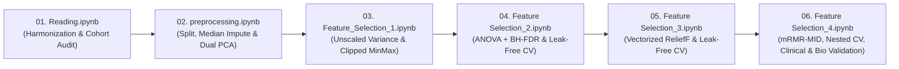

# Jupyter notebooks pipeline

This directory contains the 6 sequential interactive notebooks implementing the complete **Breast-Cancer-MultiOmics** workflow. All preprocessing, leak-free feature selection, repeated nested cross-validation, ablation studies, held-out testing, clinical validation, and biological database analyses execute directly inside these notebooks.

## Sequential execution flow

## Notebook specifications

### 1. `Reading.ipynb`
- **Objective.** Load TCGA-BRCA Firehose clinical, RNA-Seq, and DNA methylation files, synchronize common patients (`N = 549`), and audit raw data properties.
- **Operations.** Asserts zero duplicate barcodes, verifies RNA-Seq is already `log2(RSEM + 1)` (`[0.0, 20.98]`, 0 NaNs) and Methylation is 0.5-centered beta (`[-0.4969, +0.4964]`, 4,293 NaNs across 1,327 genes), checks 50/50 canonical PAM50 presence in both modalities, summarizes clinical covariates (`Tumor_purity`, `overall_survival`, stage, age, sparse IHC receptors), and runs a Kruskal-Wallis test of tumor purity across subtypes.
- **Outputs.** `outputs/X_rna_raw.parquet`, `outputs/X_meth_raw.parquet`, `outputs/y_labels.parquet`, `outputs/clinical_metadata.parquet`, `outputs/patient_ids.pkl`, `outputs/rna_feature_names.pkl`, `outputs/meth_feature_names.pkl`.

### 2. `preprocessing.ipynb`
- **Objective.** Isolate the held-out test set and run leak-free median imputation with dual-omics PCA diagnostics.
- **Operations.** Stratified 80/20 split (`N_train = 439`, `N_test = 110`, `SPLIT_SEED = 100`), persists raw train/test splits (`X_train/test_*_raw.npz`) for outer-fold nested CV, fits `SimpleImputer(strategy='median', keep_empty_features=True)` strictly on train, verifies zero NaNs and exact column counts, and plots 2x2 PCA for both RNA-Seq and Methylation colored by PAM50 subtype and tumor purity.
- **Outputs.** `outputs/X_train/test_*_raw.npz`, `outputs/X_train/test_*_imp.npz`, `outputs/y_train.parquet`, `outputs/y_test.parquet`, `outputs/train_patient_ids.pkl`, `outputs/test_patient_ids.pkl`.

### 3. `Feature_Selection_1.ipynb`
- **Objective.** Remove the bottom 20% lowest-variance features per modality on unscaled data, audit PAM50 retention, and scale to `[0, 1]`.
- **Operations.** Computes unscaled training variance (20th percentile `0.2690` for RNA, keeping 16,124/20,155; `0.00062` for Methylation, keeping 16,084/20,106), verifies 50/50 RNA and 45/50 Methylation PAM50 survival, applies `MinMaxScaler(clip=True)` confirming test bounds in `[0.0, 1.0]`, and plots log-variance distributions.
- **Outputs.** `outputs/X_train/test_*_var.npz`, `outputs/feat_indices_*_var.npz`, `outputs/feat_names_*_var.pkl`.

### 4. `Feature Selection_2.ipynb`
- **Objective.** Filter to top 500 statistically significant features per modality using ANOVA F-tests with Benjamini-Hochberg FDR control.
- **Operations.** Computes F-scores and BH-FDR q-values, runs strictly in-fold 5-fold CV (shrinkage LDA, `89.75%` accuracy at `k = 500`) starting from raw splits, and generates a leak-free sensitivity curve across `k in [100, 250, 500, 750, 1000]`.
- **Outputs.** `outputs/X_train/test_*_anova.npz`, `outputs/feat_indices_*_anova.npz`, `outputs/feat_names_*_anova.pkl`, `outputs/results/cv_accuracy_vs_k_anova.png`.

### 5. `Feature Selection_3.ipynb`
- **Objective.** Rank non-linear multi-class margin features using vectorized Kononenko (1994) ReliefF (top 150 per modality).
- **Operations.** Runs vectorized `reliefF_multiclass` (~0.08s per modality), plots ReliefF weight distributions, executes strictly in-fold 5-fold CV (shrinkage LDA, `87.69%` accuracy at `k = 150`) from raw splits, and generates a leak-free sensitivity curve across `k in [50, 100, 150, 200, 250]`.
- **Outputs.** `outputs/X_train/test_*_relief.npz`, `outputs/feat_indices_*_relief.npz`, `outputs/feat_names_*_relief.pkl`, `outputs/results/cv_accuracy_vs_k_relieff.png`.

### 6. `Feature Selection_4.ipynb`
- **Objective.** Perform final mRMR-MID biomarker selection (top 50), repeated nested CV from raw splits, leak-free ablation study, single-pass held-out evaluation, clinical validation, and multi-database biological validation.
- **Operations.**
  - Selects 50 biomarkers (`43 RNA + 7 Methylation`) via fast vectorized `mRMR-MID` and saves `outputs/final_50_features.csv`.
  - Measures full-chain 5-fold Jaccard stability (`0.4043 ± 0.0494`, 18 features selected in 5/5 folds) and leak-free mRMR sensitivity (`k in [10..100]`).
  - Runs 5x2 repeated nested CV from raw train splits with `SMOTE` strictly inside `imblearn.pipeline.Pipeline` inside `GridSearchCV`, comparing `SMOTE` and `class_weight='balanced'` across `SVM (Linear)`, `Random Forest`, `KNN (Tuned)`, and `Logistic Regression (L2)`.
  - Runs a leak-free 7-configuration ablation study directly inside the notebook.
  - Evaluates all 4 tuned models once on the held-out test set (`N = 110`) with 95% bootstrap CIs, multi-class OvR ROC-AUC / Macro PR-AUC, confusion matrices, ROC plots, and permutation feature importance, saving trained models and CSVs directly to `outputs/`.
  - Runs cis RNA-methylation Spearman correlation (`50/50` significant at BH-FDR < 0.05), tumor purity confounder testing, and Kaplan-Meier + Mantel-Cox log-rank survival analysis (`p = 0.0201` on full cohort).
  - Integrates and plots verified outputs from Ensembl GRCh38, Reactome, STRING v12 (`Homo sapiens`, Taxon ID `9606`), Open Targets, Human Protein Atlas, UniProt, AlphaFold DB, ClinicalTrials.gov, and PubMed, assembling `outputs/results/integrated_biomarker_scorecard.csv`.
- **Outputs.** `outputs/models/*.pkl`, `outputs/final_50_features.csv`, `outputs/Final_*`, and all evaluation, clinical, and biological tables and figures in `outputs/results/`.

## Execution notes

1. Run notebooks in strict sequential order `01` through `06` so each stage reads fresh artifacts produced by the preceding notebook.
2. Paths resolve automatically via `src.utils.resolve_dir` whether executed from the repository root or from `notebooks/`.
3. Global random seeds (`SPLIT_SEED = 100`, `RANDOM_STATE = 42`) are fixed across all notebooks and match `run_pipeline.py`.
